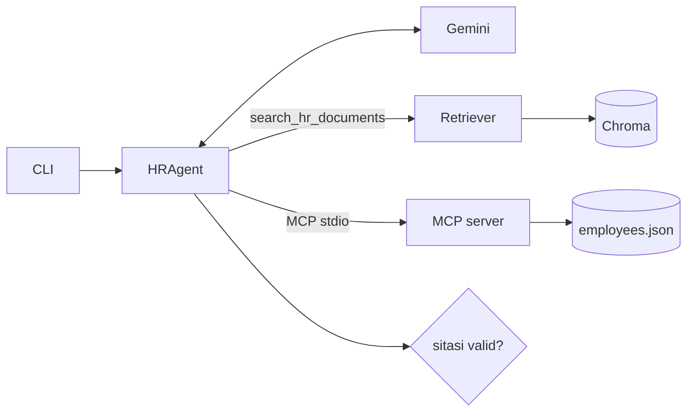

# HR Assistant: RAG + MCP Agent

Chatbot HR internal berbasis CLI. Chatbot ini menjawab pertanyaan kebijakan dari dokumen HR (RAG), mengambil data cuti dan bawahan karyawan lewat MCP server, dan menjawab "tidak tahu" kalau jawabannya tidak ada di dokumen.

Dokumen HR di `data/docs/` dan data karyawan di `data/employees.json` adalah contoh fiktif untuk demo.

## Isi repo

| Kebutuhan | Lokasi |
|---|---|
| 1. Diagram arsitektur dan justifikasi komponen | [docs/architecture.md](docs/architecture.md) |
| 2. Pipeline RAG: chunking, embedding, vector store, retrieval top-k | `src/hr_assistant/chunking.py`, `embeddings.py`, `vector_store.py`, `rag.py` |
| 3. MCP server dengan `get_leave_balance` dan `get_subordinat_list` | `src/hr_assistant/mcp_server.py` |
| 4. Agent dengan tool calling lewat MCP, guardrail, harness dan loop | `src/hr_assistant/agent.py`, `llm.py`, `prompts.py`, `evals.py` |
| 5. Dokumentasi | README ini |
| Test otomatis | `tests/` (60 test, tanpa jaringan) |

## Setup

Butuh Python 3.12 dan [uv](https://docs.astral.sh/uv/).

```bash
uv venv .venv --python 3.12
```

```bash
uv pip install --python .venv/Scripts/python.exe -e ".[dev]"
```

Salin `.env.example` menjadi `.env`, lalu isi `GEMINI_API_KEY` dengan key gratis dari [Google AI Studio](https://aistudio.google.com/apikey). Model bisa diganti lewat `GEMINI_MODEL` (default `gemini-3.8-flash`).

Di macOS atau Linux, ganti `.venv/Scripts/python.exe` dengan `.venv/bin/python` di semua perintah.

## Menjalankan

Buat index dari dokumen. Run pertama mengunduh model embedding sekitar 1 GB.

```bash
.venv/Scripts/python.exe -m hr_assistant ingest
```

```text
Index dibuat: 22 chunk dari 5 dokumen.
```

Pertanyaan kebijakan (lewat RAG):

```bash
.venv/Scripts/python.exe -m hr_assistant ask "Berapa jatah cuti tahunan?"
```

Pertanyaan data pribadi (lewat MCP). ID karyawan dummy: `E001` (manager), `E002`, `E003`.

```bash
.venv/Scripts/python.exe -m hr_assistant ask "Sisa cuti saya berapa?" --employee-id E001
```

Pertanyaan di luar dokumen, yang harus dijawab "tidak tahu":

```bash
.venv/Scripts/python.exe -m hr_assistant ask "Berapa gaji direktur utama?"
```

Tambahkan `--trace` untuk melihat setiap langkah agent (panggilan LLM, tool, guardrail) sebagai JSON. Mode interaktif tersedia lewat `chat --employee-id E001`.

Kalau muncul `LLM tidak tersedia: 404 NOT_FOUND ... ganti GEMINI_MODEL`, model default belum tersedia untuk key kamu. Isi `GEMINI_MODEL` di `.env` dengan model yang ada di daftar Google AI Studio, misalnya `gemini-2.5-flash`. Kalau muncul `429 RESOURCE_EXHAUSTED`, kuota gratis per menit habis; tunggu sebentar lalu ulangi.

Menjalankan eval harness (12 kasus, jeda 4 detik antar kasus untuk kuota gratis):

```bash
.venv/Scripts/python.exe -m hr_assistant eval
```

MCP server juga bisa dijalankan sendiri, misalnya untuk diuji dengan MCP Inspector:

```bash
.venv/Scripts/python.exe -m hr_assistant.mcp_server
```

Menjalankan test:

```bash
.venv/Scripts/python.exe -m pytest -q
```

## Arsitektur singkat



Agent mengirim pertanyaan ke Gemini bersama dua jenis tool: `search_hr_documents` (RAG lokal) dan tool yang ditemukan dari MCP server lewat `list_tools`. Gemini memilih tool dan agent mengeksekusinya. Tool MCP dipanggil lewat `call_tool` ke proses MCP server terpisah, bukan dengan memanggil fungsi Python langsung. Penjelasan lengkap, diagram urutan, dan alasan tiap komponen ada di [docs/architecture.md](docs/architecture.md).

## Trade-off

**Chunk per heading, maksimal 700 karakter dengan overlap 100.** Dokumen HR sudah terstruktur per bagian, jadi satu bagian biasanya berisi satu aturan utuh. Memotong di heading menjaga aturan tetap utuh, dan path heading (misalnya `Kebijakan Cuti > Cuti Tahunan`) ikut di-embed supaya konteksnya tidak hilang. Batas 700 karakter mengikuti jendela input model embedding. Bagian yang lebih panjang dipotong per kalimat dengan overlap, supaya kalimat di batas potongan tidak terputus.

**Chroma, bukan pgvector atau FAISS.** Chroma cukup satu folder lokal tanpa server, menyimpan metadata bersama vektor, dan sudah menyediakan cosine similarity. FAISS lebih cepat untuk jutaan vektor, tetapi metadata dan persistensi harus diurus sendiri. Untuk 200 halaman dokumen, kecepatan bukan masalah. Di production, pgvector lebih cocok supaya index berada di database yang sama dengan data HR dan ikut kontrol aksesnya.

**Embedding lokal, bukan API.** Ingest tidak memakai kuota dan dokumen internal tidak dikirim ke luar. Harganya: unduhan model sekitar 1 GB, dan kualitasnya sedikit di bawah model embedding API terbaru.

**Ambang skor 0,45.** Ambang ini dipilih dari uji kalibrasi dengan model embedding sungguhan. Pertanyaan yang jawabannya ada di dokumen mendapat skor 0,55 sampai 0,82, sedangkan pertanyaan di luar dokumen 0,12 sampai 0,42. Ambang lebih tinggi menambah jawaban "tidak tahu" yang sebenarnya bisa dijawab. Ambang lebih rendah menambah risiko model diberi konteks yang tidak relevan.

**Satu kali revisi sebelum "tidak tahu".** Kalau jawaban pertama tidak punya sitasi valid, agent diberi satu pesan koreksi. Ini memulihkan kasus model lupa menulis sitasi, dengan biaya satu panggilan LLM tambahan. Lebih dari satu revisi jarang membantu dan membuat jawaban lambat.

**Guardrail berbasis sitasi dan angka.** Jawaban dari dokumen harus menunjuk chunk yang benar-benar diambil. Jawaban dari tool MCP tanpa sitasi hanya lolos kalau setiap angka di dalamnya muncul di hasil tool, sehingga aturan karangan seperti "carry over maksimal 6 hari" ditolak. Guardrail ini belum memeriksa apakah isi kalimat benar-benar didukung chunk, dan angka yang ditulis dengan huruf ("dua kali") tidak ikut diperiksa. Pemeriksaan isi butuh LLM judge atau model NLI, dan masuk rencana eval di bawah.

## Harness dan loop engineering

Harness di sini adalah kerangka yang menjalankan, membatasi, dan memeriksa loop agent. Ada empat bagian:

1. **Loop agent terbatas.** Agent menjalankan loop panggil LLM, eksekusi tool, lalu kirim hasil, sampai model memberi jawaban final atau batas `max_steps` (6) tercapai. Kalau batas tercapai, agent menjawab "tidak tahu" dengan `stop_reason=max_steps`, bukan menggantung.
2. **Verifikasi lalu revisi.** Jawaban final diperiksa guardrail. Kalau gagal, loop berlanjut dengan pesan koreksi, lalu diperiksa lagi. Ini loop verify-and-retry yang dibatasi satu kali revisi.
3. **Error tool dikembalikan ke model.** Error dari MCP (misalnya ID `E999` tidak ditemukan) atau nama tool yang tidak ada dikirim balik ke model sebagai hasil tool, bukan menghentikan program. Model bisa menyampaikan error itu atau mencoba tool lain.
4. **Eval harness.** `python -m hr_assistant eval` menjalankan 12 kasus di `evals/cases.json` lewat agent yang sama, lalu menilai empat cek per kasus:
   - `route`: tool yang dipakai sesuai harapan
   - `contains`: jawaban memuat fakta kunci
   - `source`: sitasi menunjuk bagian dokumen yang benar
   - `refusal`: "tidak tahu" hanya muncul di kasus yang memang di luar dokumen

   Laporan JSON ditulis ke `logs/eval_report.json`. Kegagalan per cek menunjukkan bagian mana yang perlu diperbaiki: retrieval, pemilihan tool, atau guardrail.

## Evaluasi untuk production

Eval harness di repo ini adalah titik awal. Untuk production, eval berikut perlu ditambahkan:

- **Golden set dari pertanyaan sungguhan.** Kumpulkan 100 sampai 200 pertanyaan dari log chatbot dan tiket HR, lalu minta tim HR menulis jawaban acuan dan bagian dokumen sumbernya. Perbarui setiap kali kebijakan berubah.
- **Metrik retrieval.** Recall@k dan MRR terhadap bagian sumber yang benar, untuk mendeteksi masalah chunking atau embedding secara terpisah dari LLM.
- **Faithfulness dengan LLM judge.** Model penilai memeriksa apakah setiap klaim di jawaban didukung chunk yang dikutip. Penilai dikalibrasi dulu terhadap penilaian manusia pada sampel kecil.
- **Akurasi penolakan.** Dua angka terpisah: seberapa sering agent menolak pertanyaan yang bisa dijawab, dan seberapa sering agent menjawab pertanyaan yang seharusnya ditolak. Angka kedua yang paling berbahaya untuk chatbot HR.
- **Akurasi pemilihan tool.** Persentase pertanyaan data pribadi yang benar-benar memakai tool MCP dengan argumen ID yang benar.
- **Regression gate di CI.** Eval dijalankan pada setiap perubahan prompt, model, chunking, atau ambang. Perubahan ditolak kalau faithfulness atau akurasi penolakan turun melewati batas yang disepakati.
- **Monitoring online.** Tombol jempol atas/bawah, sampling percakapan untuk ditinjau manusia setiap minggu, latensi per langkah dari trace, dan rasio jawaban "tidak tahu" sebagai sinyal dokumen yang kurang lengkap.

## Status verifikasi

- 60 test otomatis lulus (`pytest -q`). Test tidak memakai jaringan: embedder palsu, LLM skrip, dan MCP server in-process. Satu test menjalankan MCP server sungguhan lewat stdio.
- `ingest` sudah dijalankan dengan model embedding sungguhan: 22 chunk dari 5 dokumen.
- Jalur CLI sampai Gemini sudah diuji dengan key yang sengaja salah. Agent menyalakan MCP server lewat stdio, memuat embedder, memanggil Gemini, lalu menampilkan error satu baris: `LLM tidak tersedia: 400 INVALID_ARGUMENT: API key not valid.`
- Demo dengan key Gemini asli dan hasil `eval` belum dijalankan, karena key belum tersedia saat repo ini dibuat.

## Keterbatasan

- Data karyawan adalah dummy di berkas JSON, tanpa autentikasi. Di production, ID karyawan harus diambil dari sesi login, bukan dari argumen yang bisa diisi siapa saja, dan MCP server harus memeriksa bahwa penanya hanya boleh melihat datanya sendiri atau data bawahannya.
- Guardrail memeriksa sitasi dan angka, belum memeriksa kebenaran isi kalimat (lihat Trade-off).
- Pertanyaan lanjutan di mode `chat` belum membawa riwayat percakapan sebelumnya. Setiap pertanyaan diproses sendiri.
- Index dibangun ulang penuh setiap `ingest`. Untuk dokumen yang sering berubah, perlu ingest inkremental berdasarkan hash berkas.
