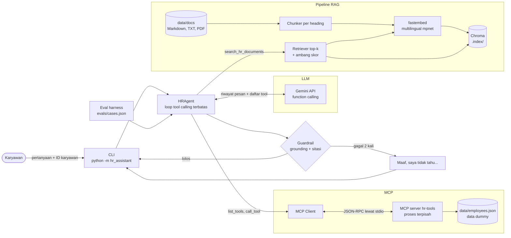
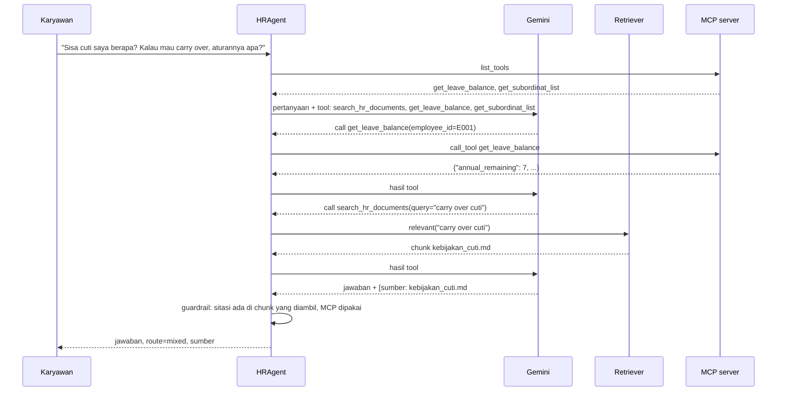

# Arsitektur HR Assistant

Dokumen ini menjelaskan komponen, alurnya, cara agent memilih antara RAG dan tool MCP, serta alasan setiap pilihan komponen.

## Diagram komponen

## Alur keputusan RAG atau MCP

Yang memilih tool adalah Gemini, berdasarkan deskripsi tool dan aturan di system prompt (`src/hr_assistant/prompts.py`):

- Pertanyaan tentang data pribadi (sisa cuti, bawahan) diarahkan ke tool MCP, dengan ID karyawan dari pesan.
- Pertanyaan tentang kebijakan dan prosedur diarahkan ke `search_hr_documents`.
- Pertanyaan yang butuh keduanya boleh memakai keduanya dalam satu loop.

Pilihan model itu tidak dipercaya begitu saja. Setelah model memberi jawaban final, guardrail deterministik di `agent.py` memeriksa jawabannya:

1. Jawaban harus berasal dari hasil tool. Hasil MCP (sukses atau error) dihitung sebagai sumber. Jawaban dari dokumen wajib menyertakan sitasi `[sumber: <source_id>]`.
2. Setiap sitasi harus cocok dengan chunk yang benar-benar diambil retriever untuk pertanyaan ini. Sitasi karangan langsung ditolak.
3. Kalau gagal, agent diberi satu pesan koreksi dan satu kesempatan lagi. Kalau masih gagal, jawabannya diganti dengan kalimat baku: "Maaf, saya tidak tahu. Informasi itu tidak ada di dokumen HR yang saya punya."
4. Retriever hanya mengembalikan chunk dengan skor kemiripan minimal 0,45. Pertanyaan di luar dokumen mendapat `found=false`, sehingga model tidak punya bahan untuk mengarang.

## Alasan pilihan komponen

**Gemini (google-genai SDK).** Ada kuota gratis lewat Google AI Studio, jadi demo bisa dijalankan tanpa biaya, dan function calling-nya mendukung JSON Schema, sehingga skema tool MCP bisa diteruskan apa adanya. Automatic function calling di SDK sengaja dimatikan, supaya loop, batas langkah, dan guardrail dikendalikan kode sendiri. Model bisa diganti lewat `GEMINI_MODEL` tanpa mengubah kode.

**fastembed dengan `paraphrase-multilingual-mpnet-base-v2`.** Model ini berjalan lokal di CPU lewat ONNX, jadi ingest tidak memakai kuota API dan dokumen internal tidak keluar dari mesin. Model ini dilatih untuk sekitar 50 bahasa termasuk Bahasa Indonesia, dan pada uji kalibrasi pertanyaan berbahasa Inggris tetap menemukan bagian Cuti Tahunan. Ukurannya sekitar 1 GB, sehingga hanya diunduh sekali.

**Chroma.** Chroma menyimpan vektor dan metadata (`source`, `section`) di folder lokal `.index/`, tanpa server database, cocok untuk demo lokal. Pencarian memakai cosine similarity, dan skornya dipakai untuk ambang guardrail. Untuk production, pgvector lebih masuk akal karena bisa satu database dengan data HR dan punya kontrol akses yang sudah ada.

**MCP lewat stdio.** MCP server berjalan sebagai proses terpisah (`python -m hr_assistant.mcp_server`), dan agent hanya mengenal tool dari `list_tools`. Jadi menambah tool baru cukup di server, tanpa mengubah agent. Transport stdio paling sederhana untuk lokal. Di production, server yang sama bisa dijalankan dengan transport streamable HTTP di belakang autentikasi.

**Guardrail deterministik di kode, bukan hanya di prompt.** Instruksi "jangan mengarang" di prompt bisa diabaikan model. Pemeriksaan sitasi di kode tidak bisa, sehingga perilaku "tidak tahu" bisa diuji dengan test otomatis (`tests/test_agent.py`).

**Loop dengan batas langkah.** Loop berhenti setelah `max_steps` (default 6) panggilan LLM, sehingga model yang terus memanggil tool tidak membuat biaya atau waktu tunggu tak terbatas. Setiap langkah dicatat sebagai `Step` dan bisa dicetak dengan `--trace`.
